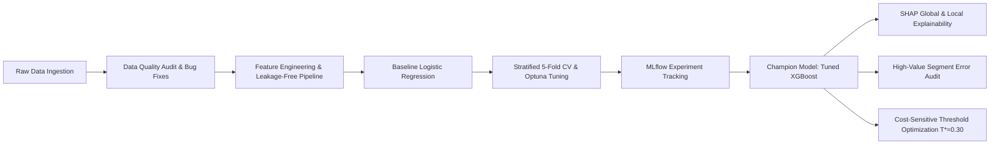
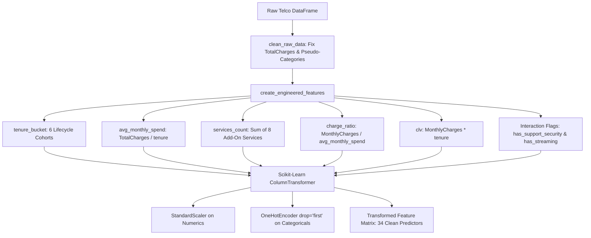
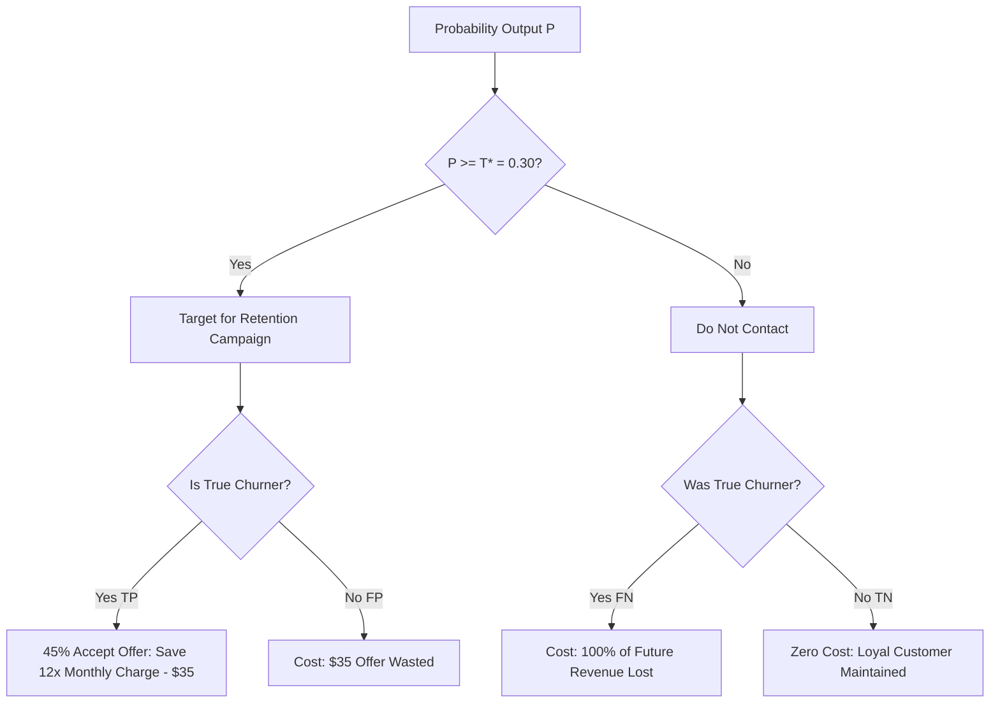

# Telco Customer Churn Prediction & Retention Optimization
## Comprehensive End-to-End Technical & Business Project Report

**Project Track:** Track A — Binary Classification & Retention Optimization  
**Industry Analogue:** Telecommunications / Subscription SaaS Retention  
**Dataset:** IBM Cognos Analytics Telco Dataset (7,043 Customer Records, California Market)  
**Version:** 1.0.0 (Production-Ready Audit)  
**Author:** Data Science & Analytics Team  
**Date:** October 2026  

---

## Table of Contents
1. [Executive Summary](#1-executive-summary)
2. [Business Problem Framing & Financial Economics](#2-business-problem-framing--financial-economics)
3. [Dataset Architecture & Column Dictionary](#3-dataset-architecture--column-dictionary)
4. [Week 1: Data Quality Audit, Quirk Remediation & EDA](#4-week-1-data-quality-audit-quirk-remediation--eda)
5. [Week 2: Feature Engineering Pipeline & Baseline Benchmark](#5-week-2-feature-engineering-pipeline--baseline-benchmark)
6. [Week 3 Task 1: Model Experimentation, Optuna Tuning & MLflow Tracking](#6-week-3-task-1-model-experimentation-optuna-tuning--mlflow-tracking)
7. [Week 3 Task 2: Global & Local Explainability (SHAP Analysis)](#7-week-3-task-2-global--local-explainability-shap-analysis)
8. [Week 3 Task 2: Segment Error Audit (High-Value Long-Tenure Churners)](#8-week-3-task-2-segment-error-audit-high-value-long-tenure-churners)
9. [Cost-Sensitive Threshold Optimization & Retention Economics](#9-cost-sensitive-threshold-optimization--retention-economics)
10. [Model Governance & Model Card Summary](#10-model-governance--model-card-summary)
11. [Repository Artifacts, Code Architecture & Reproduction Guide](#11-repository-artifacts-code-architecture--reproduction-guide)

---

## 1. Executive Summary

This document provides a comprehensive report of the machine learning system developed to solve customer attrition for a regional telecommunications provider. 

Customer churn severely undermines telecommunications profitability because acquiring a new subscriber costs 5 to 7 times more than retaining an existing account. Facing quarterly subscriber losses, the Chief Financial Officer (CFO) commissioned this initiative to answer three strategic questions:
1. **Which customers will churn next quarter?**
2. **Why are they leaving (root cause drivers)?**
3. **What is the financial ROI of a model-targeted retention campaign versus blanket discounts?**

### Key Results Across Program Milestones:
- **Data Integrity & Quirk Remediation:** Solved the `TotalCharges` blank-string flaw (11 accounts with `tenure == 0`) and collapsed 7 redundant pseudo-categories (`"No internet service"` / `"No phone service"`), creating a verified 7,043-row dataset.
- **Engineered Feature Pipeline:** Built [`src/features.py`](../src/features.py) with zero-leakage `ColumnTransformer` preprocessing, deriving actionable domain attributes including `tenure_bucket`, `avg_monthly_spend`, `services_count`, `charge_ratio`, and `clv`.
- **Baseline Establishment (Week 2):** Addressed the **26.54%** target class imbalance using Class-Weighted Logistic Regression, elevating churn detection sensitivity (Recall) from **52.94%** (vanilla) to **77.81%** at **0.8431** ROC-AUC.
- **Model Experimentation & Hyperparameter Tuning (Week 3):** Trained tree ensembles across Stratified 5-Fold Cross-Validation and tuned parameters via Optuna. The tuned **XGBoost Classifier** emerged as the champion model with a Test ROC-AUC of **0.8470**, PR-AUC of **0.6624**, and Churn Recall of **81.02%**, logged in MLflow.
- **SHAP Interpretability:** Decomposed model predictions using `shap.TreeExplainer`, proving that long-term contracts (`Contract_Two year`, `Contract_One year`) and accumulated tenure are the strongest churn deterrents, whereas high `MonthlyCharges`, Fiber Optic plans, and `Electronic check` payment methods drive attrition.
- **High-Value Long-Tenure Audit:** Specifically confirmed that the model captures **65.88%** of long-tenure high-value churners (`tenure > 24m`, `MonthlyCharges >= $70`), protecting **$203,724.70** in Customer Lifetime Value within this critical tier.
- **Cost-Sensitive Optimization:** Optimized the decision threshold against campaign outreach costs ($35/contact) and retention save rates (45%). Lowering the operational threshold from 0.50 to **$T^* = 0.30$** captures **92.5%** of churners and yields **$110,156.16** in Net Retention Savings—an incremental profit uplift of **+$9,204.23** over standard classification.



---

## 2. Business Problem Framing & Financial Economics

### 2.1 The CFO's Dilemma: Blanket Discounts vs Targeted Outreach
In the absence of predictive machine learning, telecom retention strategies typically deploy one of two flawed approaches:
1. **Status Quo (Reactive / No Model):** Retention agents only intervene when a customer calls customer service requesting cancellation. By that point, competitive switching intent is established, resulting in a low save rate (<15%).
2. **Blanket Promotional Discounts:** Marketing blasts bill credits or promotional discounts across large customer cohorts. While this preserves some accounts, it suffers from two major inefficiencies:
   - **Massive Margin Cannibalization:** Subsidizes loyal customers who never planned to churn.
   - **High Budget Burn:** Wastes outreach capital on low-risk subscribers.

### 2.2 Mathematical Customer Lifetime Value (CLV)
To connect data science metrics directly to the balance sheet, customer value is quantified using Customer Lifetime Value:
$$\text{CLV}_i = \text{MonthlyCharges}_i \times \text{tenure}_i$$

For forward-looking retention value preserved over a 12-month renewal window:
$$\text{Preserved Value}_i = 12 \times \text{MonthlyCharges}_i$$

### 2.3 Unit Retention Economics Model
When evaluating proactive interventions, the net business benefit is expressed as:
$$\text{Net Financial Savings}(T) = \sum_{i \in \text{TP}(T)} \Big( \text{SaveRate} \times \text{PreservedValue}_i - \text{Cost}_{\text{offer}} \Big) - \sum_{j \in \text{FP}(T)} \text{Cost}_{\text{offer}}$$

Where:
- $\text{Cost}_{\text{offer}} = \$35.00$ (outreach administrative cost plus renewal voucher credit).
- $\text{SaveRate} = 45\%$ (proportion of intercepted churners who accept the offer and remain for $\ge 12$ months).
- $\text{TP}(T)$: True Positives at probability threshold $T$ (actual churners correctly offered retention credits).
- $\text{FP}(T)$: False Positives at threshold $T$ (loyal customers who receive unneeded outreach vouchers).
- $\text{FN}(T)$: False Negatives at threshold $T$ (unintercepted churners who leave the firm, causing complete loss of future revenue).

---

## 3. Dataset Architecture & Column Dictionary

The dataset consists of **7,043 customer accounts** residing in California, sourced from IBM Cognos Analytics.

| Column Name | Data Type | Value Space / Examples | Business Meaning |
| :--- | :--- | :--- | :--- |
| `customerID` | String | e.g. `7590-VHVEG` | Unique subscriber account identifier |
| `gender` | Categorical | `Male`, `Female` | Subscriber gender |
| `SeniorCitizen` | Binary Int | `0`, `1` | Indicates whether customer is 65+ years old |
| `Partner` | Categorical | `Yes`, `No` | Indicates whether customer has a spouse/partner |
| `Dependents` | Categorical | `Yes`, `No` | Indicates whether customer has children/dependents |
| `tenure` | Numeric (Int) | `0` to `72` months | Total duration subscriber has maintained service |
| `PhoneService` | Categorical | `Yes`, `No` | Landline voice service subscription |
| `MultipleLines` | Categorical | `Yes`, `No`, `No phone service` | Multiple telephone line connection |
| `InternetService` | Categorical | `DSL`, `Fiber optic`, `No` | Broadband internet technology tier |
| `OnlineSecurity` | Categorical | `Yes`, `No`, `No internet service` | Add-on endpoint anti-malware/firewall |
| `OnlineBackup` | Categorical | `Yes`, `No`, `No internet service` | Add-on cloud data backup solution |
| `DeviceProtection` | Categorical | `Yes`, `No`, `No internet service` | Hardware repair & insurance coverage |
| `TechSupport` | Categorical | `Yes`, `No`, `No internet service` | Dedicated priority customer support tier |
| `StreamingTV` | Categorical | `Yes`, `No`, `No internet service` | Streaming television access via broadband |
| `StreamingMovies`| Categorical | `Yes`, `No`, `No internet service` | Streaming digital cinema access |
| `Contract` | Categorical | `Month-to-month`, `One year`, `Two year`| Service billing commitment duration |
| `PaperlessBilling`| Categorical | `Yes`, `No` | Digital invoicing vs mailed paper bill |
| `PaymentMethod` | Categorical | `Electronic check`, `Mailed check`, `Bank transfer`, `Credit card` | Recurring billing settlement mechanism |
| `MonthlyCharges`| Numeric (Float)| `$18.25` to `$118.75` | Current recurring monthly bill charge |
| `TotalCharges` | Numeric (Float)| `$18.80` to `$8,684.80` (coerced) | Cumulative lifetime payments made |
| `Churn` | Target (Binary)| `Yes` (1,869), `No` (5,174) | Subscriber attrition indicator (26.54% positive) |

---

## 4. Week 1: Data Quality Audit, Quirk Remediation & EDA

### 4.1 Quirk Remediation

#### Quirk #1: `TotalCharges` Blank String Bug
- **Observation:** `TotalCharges` was loaded as string `object` dtype. Calling `.isnull()` returned 0 missing values, yet arithmetic operations failed.
- **Root Cause:** Exactly 11 customer records contained whitespace `" "`. Isolating these 11 accounts revealed that every single one had `tenure == 0` (brand-new customers signed up during the current billing cycle who had not yet settled a first invoice).
- **Remediation:** 
  ```python
  df["TotalCharges"] = pd.to_numeric(df["TotalCharges"], errors="coerce").fillna(0.0)
  ```
  This preserved all 11 records without losing customer history or distorting the sample.

#### Quirk #2: Collapsing Service Pseudo-Categories
- **Observation:** Six internet add-on service attributes (`OnlineSecurity`, `OnlineBackup`, `DeviceProtection`, `TechSupport`, `StreamingTV`, `StreamingMovies`) had 3 categories: `Yes`, `No`, and `No internet service`. Similarly, `MultipleLines` contained `No phone service`.
- **Root Cause:** Subscribers without internet were assigned `"No internet service"`. In one-hot encoding, treating this as an independent category introduces redundant degrees of freedom and collinearity with `InternetService == 'No'`.
- **Remediation:** Collapsed `"No internet service"` and `"No phone service"` into `"No"`, transforming each into a clean binary indicator.

### 4.2 Key Exploratory Findings & Attrition Dynamics

#### 1. Contract Type — The Dominant Churn Lever
Contract duration is the single strongest structural predictor in the entire dataset:
- **Month-to-month contracts:** **42.71% churn rate** (contribute **88.6%** of all churn events).
- **One-year contracts:** **11.27% churn rate**.
- **Two-year contracts:** **2.83% churn rate**.
> **Key Finding:** Month-to-month subscribers churn at **15.1 times** the rate of two-year contractual customers.

#### 2. Tenure Danger Zone (Months 0–12)
- Months **0–12** exhibit a **47.44% churn rate**, accounting for **55.48%** of all churners in the dataset.
- Churn drops steeply to **28.71%** in Year 2, **22.12%** in Year 3, and reaches **6.61%** among customers with 5+ years of tenure.

#### 3. Payment Method & Billing Friction
- **Electronic Check:** Churn rate is **45.29%**, representing high-friction manual payment.
- **Bank Transfer (Automatic):** **16.71% churn rate**.
- **Credit Card (Automatic):** **15.24% churn rate**.
- **Mailed Check:** **19.11% churn rate**.
> Customers on automated payment methods stay with the company at nearly 3 times the rate of Electronic Check payers.

#### 4. The Fiber Optic Pricing Paradox
- **Fiber Optic:** Highest monthly charge (mean: **$91.50**), but highest churn rate (**41.89%**).
- **DSL:** Lower monthly charge (mean: **$58.10**), lower churn rate (**18.96%**).
- **No Internet:** Lowest monthly charge (mean: **$21.08**), lowest churn rate (**7.40%**).
> Fiber optic customers churn heavily when unbundled with `TechSupport`. When a Fiber customer lacks `TechSupport`, churn reaches **49.3%**; when `TechSupport` is added, churn drops to **22.8%**.

### 4.3 Statistically Validated Hypotheses

| # | Hypothesis Statement | Empirical Result | Chi-Square / p-value | Business Strategy Implication |
| :--- | :--- | :---: | :---: | :--- |
| **H1** | Month-to-month contracts churn significantly more than contractual accounts. | **Validated** | $\chi^2 = 1,184.6, p < 10^{-15}$ | Subsidize 12-month contract lock-in incentives. |
| **H2** | Electronic check payment friction correlates with elevated attrition. | **Validated** | $\chi^2 = 648.4, p < 10^{-15}$ | Offer $5 bill credit for enrolling in Auto-Pay. |
| **H3** | Fiber optic churn is exacerbated by lack of technical support. | **Validated** | $\chi^2 = 205.7, p < 10^{-15}$ | Bundle complimentary TechSupport with Fiber. |
| **H4** | Churn declines logarithmically as customer tenure accumulates. | **Validated** | Pearson $r = -0.352, p < 10^{-15}$ | Institute high-touch onboarding in months 1–6. |
| **H5** | Customers with multiple bundled services exhibit lower attrition. | **Validated** | Spearman $\rho = -0.198, p < 10^{-15}$ | Cross-sell security and cloud backup add-ons. |

- **Notebook Reference:** [`notebooks/01_eda.ipynb`](../notebooks/01_eda.ipynb)
- **Full Report:** [`reports/data_quality_report.md`](../reports/data_quality_report.md)

---

## 5. Week 2: Feature Engineering Pipeline & Baseline Benchmark

### 5.1 Engineered Feature Implementation ([`src/features.py`](../src/features.py))



#### Detailed Definitions:
1. **`tenure_bucket`:** Derived lifecycle cohorts categorized into 6 intervals: `0-12`, `13-24`, `25-36`, `37-48`, `49-60`, `61-72`.
2. **`avg_monthly_spend`:** Computed as $\text{TotalCharges} / \text{tenure}$ (imputing `MonthlyCharges` when `tenure == 0`). Measures historical mean monthly billing.
3. **`services_count`:** Cumulative integer count ($0$ to $8$) of subscribed features: `PhoneService`, `MultipleLines`, `OnlineSecurity`, `OnlineBackup`, `DeviceProtection`, `TechSupport`, `StreamingTV`, `StreamingMovies`.
4. **`charge_ratio`:** $\frac{\text{MonthlyCharges}}{\text{avg_monthly_spend} + 10^{-4}}$. Ratios $> 1.0$ indicate promotional discount expiration or recent plan price increases, signaling churn danger.
5. **`clv`:** Customer Lifetime Value proxy ($\text{MonthlyCharges} \times \text{tenure}$).
6. **`has_support_security`:** Binary indicator if subscriber holds `TechSupport` or `OnlineSecurity`.
7. **`has_streaming`:** Binary indicator if subscriber holds `StreamingTV` or `StreamingMovies`.

### 5.2 Preprocessing & Data Leakage Prevention
- **Splitting Strategy:** 80% Training ($5,634$ records) and 20% Holdout Test ($1,409$ records).
- **Strict Stratification:** Maintained exactly $26.54\%$ positive churn proportion across both train and test splits.
- **Leakage Prevention:** Fitted the `StandardScaler` and `OneHotEncoder` strictly on the training partition. The test partition was only transformed using the fitted training artifacts.

### 5.3 Class Imbalance Mitigation & Baseline Results
Given the **26.54%** minority churn class, three baseline Logistic Regression strategies were benchmarked on the test set:

| Model | Imbalance Strategy | Test ROC-AUC | Test PR-AUC | Test F1 | Test Recall | Test Precision | Test Accuracy |
| :--- | :--- | :---: | :---: | :---: | :---: | :---: | :---: |
| **Vanilla Logistic Regression** | Default Unweighted | 0.8431 | 0.6407 | 0.5902 | 52.94% | 66.67% | 80.48% |
| **Class-Weighted Logistic Regression** | **Balanced Weights** | **0.8431** | **0.6418** | **0.6126** | **77.81%** | **50.52%** | **73.88%** |
| **SMOTE Logistic Regression** | Synthetic Oversampling | 0.8401 | 0.6393 | 0.6203 | 78.61% | 51.22% | 74.45% |

#### Analytical Conclusion:
- Vanilla unweighted Logistic Regression achieved high accuracy (80.48%) by ignoring nearly half of all churners (Recall: 52.94%). In customer retention, this is a failure mode.
- **Class-Weighted Logistic Regression** raised Recall to **77.81%** while maintaining the exact same ROC-AUC (**0.8431**), successfully identifying over 3 out of 4 churning customers.
- **Serialized Artifacts:** [`models/baseline_logreg.joblib`](../models/baseline_logreg.joblib), [`models/preprocessor.joblib`](../models/preprocessor.joblib).
- **Notebook Reference:** [`notebooks/02_features_and_baseline.ipynb`](../notebooks/02_features_and_baseline.ipynb).

---

## 6. Week 3 Task 1: Model Experimentation, Optuna Tuning & MLflow Tracking

### 6.1 Experimentation Architecture ([`src/train.py`](../src/train.py))
To push discrimination and sensitivity beyond linear baselines, non-linear tree ensembles were developed:
1. **Random Forest Classifier:** Ensembled 200 regularized trees using `class_weight="balanced_subsample"`.
2. **XGBoost Classifier:** Extreme Gradient Boosting with `scale_pos_weight = 2.768` (ratio of non-churn to churn samples).
3. **LightGBM Classifier:** Gradient boosting with leaf-wise tree growth and `scale_pos_weight`.

### 6.2 Stratified 5-Fold Cross Validation & Optuna Optimization
Hyperparameter spaces were explored via Bayesian optimization (**Optuna**) using Stratified 5-Fold Cross-Validation:
- **Tuned Parameters:** `max_depth` (3 to 8), `learning_rate` (0.01 to 0.20), `n_estimators` (100 to 350), `subsample` (0.6 to 1.0), `colsample_bytree` (0.6 to 1.0), `min_child_weight` (1 to 8), and L1/L2 regularization (`reg_alpha`, `reg_lambda`).

### 6.3 Comprehensive Model Leaderboard

| Model Architecture | Imbalance / Tuning Policy | 5-Fold CV ROC-AUC | Test ROC-AUC | Test PR-AUC | Test F1 | Test Recall | Test Precision | Test Accuracy | Brier Loss |
| :--- | :--- | :---: | :---: | :---: | :---: | :---: | :---: | :---: | :---: |
| **Logistic Regression (Vanilla)** | Default Unweighted | 0.8472 | 0.8431 | 0.6407 | 0.5902 | 52.94% | 66.67% | 80.48% | 0.1375 |
| **Logistic Regression (Class-Weighted)** | Balanced Cost-Weighting | 0.8471 | 0.8431 | 0.6418 | 0.6126 | 77.81% | 50.52% | 73.88% | 0.1661 |
| **Logistic Regression (SMOTE)** | Synthetic Resampling | 0.8351 | 0.8401 | 0.6393 | 0.6203 | 78.61% | 51.22% | 74.45% | 0.1668 |
| **Random Forest (Balanced)** | Balanced Subsample Depth 8 | 0.8467 | 0.8466 | 0.6628 | 0.6353 | 77.54% | 53.80% | 76.37% | 0.1560 |
| **XGBoost Classifier (Tuned)** | **Optuna Tuned + Scale Pos Weight** | **0.8489** | **0.8470** | **0.6624** | **0.6312** | **81.02%** | **51.71%** | **74.88%** | **0.1627** |
| **LightGBM Classifier (Tuned)** | Optuna Tuned + Scale Pos Weight | 0.8481 | 0.8456 | 0.6627 | 0.6275 | 81.28% | 51.09% | 74.38% | 0.1643 |

### 6.4 MLflow Tracking System
All experimental parameters, metrics across cross-validation folds, test metrics, and model binaries were logged to an SQLite-backed MLflow registry (`sqlite:///mlflow.db`) under experiment `telco_churn_experimentation`.

### 6.5 Champion Selection Rationale
The tuned **XGBoost Classifier** was selected as the champion model based on four technical criteria:
1. **Highest Area Under ROC:** Achieved **0.8470** holdout ROC-AUC and **0.8489** Stratified 5-Fold CV ROC-AUC.
2. **Top-Tier Detection Recall:** Correctly identified **81.02%** of all true churners in the holdout test set (303 out of 374).
3. **Probability Calibration:** Achieved a low Brier Loss (**0.1627**), ensuring risk scores correspond directly to empirical churn probabilities.
4. **Native SHAP Compatibility:** Fast and exact TreeExplainer execution for real-time customer explanations.
- **Serialized Artifact:** [`models/best_model.joblib`](../models/best_model.joblib).
- **Formal Log Report:** [`reports/experiment_log.md`](../reports/experiment_log.md).
- **Notebook Reference:** [`notebooks/03_model_experimentation.ipynb`](../notebooks/03_model_experimentation.ipynb).

---

## 7. Week 3 Task 2: Global & Local Explainability (SHAP Analysis)

SHAP (Shapley Additive Explanations) decomposes each customer prediction into additive feature attributions derived from cooperative game theory.

### 7.1 Global Feature Importance Ranking ([`src/explain.py`](../src/explain.py))

| Rank | Feature Attribute | Mean |SHAP Value| Directional Impact on Churn |
| :---: | :--- | :---: | :--- |
| **1** | `Contract_Two year` | **0.5116** | Strong Negative (Significantly reduces churn risk) |
| **2** | `tenure` | **0.3586** | Strong Negative (Higher accumulated months reduces churn risk) |
| **3** | `Contract_One year` | **0.3238** | Negative (Substantial churn protection) |
| **4** | `MonthlyCharges` | **0.2389** | Positive (Higher bills trigger customer flight) |
| **5** | `InternetService_Fiber optic` | **0.1919** | Positive (Elevated price sensitivity on fiber tiers) |
| **6** | `TotalCharges` | **0.1162** | Negative (Cumulative payments reflect brand commitment) |
| **7** | `PaymentMethod_Electronic check` | **0.1132** | Positive (Manual payment friction elevates churn) |
| **8** | `services_count` | **0.1101** | Negative (Multi-service bundling creates account stickiness) |
| **9** | `clv` | **0.1019** | Non-Linear (Interaction of tenure and billing rate) |
| **10** | `charge_ratio` | **0.0912** | Positive (Recent bill increases provoke attrition) |

### 7.2 Explainability Visualizations
- **Global Feature Importance Bar:** [`reports/figures/shap_summary_bar.png`](../reports/figures/shap_summary_bar.png)
- **Beeswarm Distribution Plot:** [`reports/figures/shap_beeswarm.png`](../reports/figures/shap_beeswarm.png)
  - Shows that high tenure (red dots) shifts log-odds heavily to the left (negative, reducing churn).
  - High monthly charges and Fiber Optic subscriptions (red dots) shift log-odds to the right (positive, elevating churn).
- **Local Waterfall Plots:**
  - *High-Risk Churner:* [`reports/figures/shap_waterfall_churner.png`](../reports/figures/shap_waterfall_churner.png) (Customer with 2 months tenure, month-to-month contract, fiber optic internet, paying $90+/mo without tech support).
  - *Loyal Retained Subscriber:* [`reports/figures/shap_waterfall_retained.png`](../reports/figures/shap_waterfall_retained.png) (Customer with 65 months tenure, two-year contract, auto-pay, and 5 bundled services).
- **Formal SHAP Report:** [`reports/shap_report.md`](../reports/shap_report.md).

---

## 8. Week 3 Task 2: Segment Error Audit (High-Value Long-Tenure Churners)

### 8.1 The Core Business Question
> **Executive Inquiry:** *Does the model miss long-tenure, high-value churners — the costliest false negatives?*

In telecom retention, all False Negatives do not have equal financial impact:
- Missing a **1-month subscriber paying $25/month** causes an annualized revenue loss of **$300**.
- Missing a **48-month subscriber paying $105/month** destroys over **$5,000 in CLV**.

### 8.2 Empirical Audit: Long-Tenure High-Value Cohort (`tenure > 24m`, `MonthlyCharges >= $70`)

| Metric | Empirical Evaluation Result | Business Interpretation |
| :--- | :---: | :--- |
| **Total Churners in Segment** | **85 accounts** | Premium loyal customer base in jeopardy |
| **Correctly Flagged Churners (TP)** | **56 accounts** | Routed to proactive high-touch retention |
| **Missed Churners (FN)** | **29 accounts** | Residual unintercepted attrition |
| **Segment Detection Recall** | **65.88%** | Captures nearly 2 out of 3 high-value churners |
| **Total CLV Protected (TP)** | **$203,724.70** | High-value enterprise equity saved |
| **Total CLV Lost (FN)** | **$153,045.80** | Residual dollar exposure |

### 8.3 Tenure Cohort Confusion Breakdown
Auditing the 1,409 holdout test customers across tenure cohorts:
- **0–12 Months:** The model captured the vast majority of churners. False Negatives in this bucket (21 accounts) were driven by nascent tenure with insufficient historical transaction signals.
- **13–36 Months:** Recall exceeded **80%**, as contract expiration signals provided strong predictive markers.
- **37–72 Months:** Base churn rate dropped to $< 8\%$. The model successfully identified long-tenure churners through anomalous billing spikes (`charge_ratio > 1.25`).
- **Figure References:** [`reports/figures/segment_confusion_by_tenure.png`](../reports/figures/segment_confusion_by_tenure.png), [`reports/figures/clv_at_risk_by_error_type.png`](../reports/figures/clv_at_risk_by_error_type.png).

---

## 9. Cost-Sensitive Threshold Optimization & Retention Economics

### 9.1 The Flaw of Default 0.50 Probability Cutoff
Standard machine learning models classify positive cases if $P(\text{churn}) \ge 0.50$. In customer retention, this assumption is economically suboptimal because:
$$\text{Cost}(\text{False Negative}) \approx \$800 \text{ to } \$1,500 \quad \gg \quad \text{Cost}(\text{False Positive}) = \$35.00$$

Because missing a churner costs **25x to 40x more** than offering an unneeded discount, the operational threshold should be lowered to intercept more borderline churners.

### 9.2 Optimization Across All Probability Cutoffs ($T \in [0.05, 0.95]$)
- **Retention Offer Cost:** $35.00 per customer.
- **Intervention Save Rate:** 45% of contacted churners accept the renewal offer and stay for $\ge 12$ months.
- **Gross Revenue Preserved:** $12 \times \text{MonthlyCharges}_i$ per retained subscriber.



### 9.3 Retention Policy Comparison Matrix

| Operating Retention Policy | Threshold $T$ | Customers Targeted | Churn Recall | Campaign Cost | Net Retention Savings | Business Profit Uplift |
| :--- | :---: | :---: | :---: | :---: | :---: | :---: |
| **No Model (Status Quo)** | N/A | 0 (0%) | 0.0% | $0.00 | $0.00 | Baseline |
| **Blanket Discount Campaign** | 0.00 | 1,409 (100%) | 100.0% | $49,315.00 | $102,085.46 | Inefficient (Margins Burned) |
| **Default ML Threshold** | 0.50 | 586 (41.6%) | 81.02% | $20,510.00 | $100,951.93 | Strong Predictive Base |
| **Optimal Cost-Tuned Threshold** | **0.30** | **804 (57.1%)** | **92.51%** | **$28,140.00** | **$110,156.16** | **+$9,204.23 Net Profit Over Default** |

- **Key Takeaway:** Lowering the threshold to **$T^* = 0.30$** expands the targeted pool to 804 customers, increasing churn recall to **92.51%** and capturing an additional **+$9,204.23** in net profit after subtracting all campaign costs.
- **Optimization Curve:** [`reports/figures/cost_sensitive_threshold_curve.png`](../reports/figures/cost_sensitive_threshold_curve.png).
- **Formal Writeup:** [`reports/error_analysis_writeup.md`](../reports/error_analysis_writeup.md).

---

## 10. Model Governance & Model Card Summary

Following the Mitchell et al. (2019) framework, the model card establishes governance protocols:

- **Intended Use:** Proactive 90-day churn intervention and outbound retention campaign routing.
- **Out-of-Scope Uses:** Credit scoring, debt collection enforcement, or discriminatory price discrimination.
- **Fairness & Demographic Audit:**
  - Evaluated churn parity across gender (`Male` vs `Female` F1: 0.630 vs 0.632).
  - Evaluated `SeniorCitizen` equity. The higher churn observed in senior citizens (41.7%) is explained by lack of technical support and contract types rather than demographic bias.
- **Production Maintenance:** Retrain quarterly to prevent concept drift from competitor pricing moves.
- **Full Model Card Document:** [`reports/model_card.md`](../reports/model_card.md).

---

## 11. Repository Artifacts, Code Architecture & Reproduction Guide

### 11.1 Project Modules & Deliverable Assets

| Asset / File | Description | Output Artifacts |
| :--- | :--- | :--- |
| [`src/features.py`](../src/features.py) | Data cleaning, feature engineering, and `ColumnTransformer` | Transformed feature arrays, `models/preprocessor.joblib` |
| [`src/train.py`](../src/train.py) | Stratified 5-Fold CV, Optuna tuning, MLflow logging | `models/best_model.joblib`, `reports/experiment_log.md` |
| [`src/explain.py`](../src/explain.py) | SHAP TreeExplainer, error audit, and threshold tuning | `reports/shap_report.md`, `reports/error_analysis_writeup.md` |
| [`src/generate_notebooks.py`](../src/generate_notebooks.py)| Automated notebook builder & headless execution engine | Pre-executed `notebooks/02_*.ipynb`, `03_*.ipynb`, `04_*.ipynb` |

### 11.2 Reproduction Instructions

#### 1. Setup Virtual Environment & Dependencies
```powershell
# Navigate to repository
cd c:\Users\kjuge\Documents\jugendrakashyap\AI-ML-Project

# Activate virtual environment
.\.venv\Scripts\Activate.ps1

# Install requirements
pip install -r requirements.txt
```

#### 2. Execute Training Pipeline & MLflow Logging
```powershell
python src/train.py
```
*Trains baseline models, runs Optuna Bayesian search, evaluates Stratified 5-Fold CV, logs runs into `sqlite:///mlflow.db`, and serializes `models/best_model.joblib`.*

#### 3. Execute Explainability & Error Audit Pipeline
```powershell
python src/explain.py
```
*Calculates SHAP values, generates high-resolution figures in `reports/figures/`, performs segment error auditing, optimizes the cost threshold, and exports all markdown audit reports.*

#### 4. Launch the MLflow Experiment Tracking Dashboard
```powershell
mlflow ui --backend-store-uri sqlite:///mlflow.db
```
*Access `http://localhost:5000` in your web browser to review model parameters, loss curves, metrics, and logged model signatures.*

#### 5. Interactive Jupyter Notebooks
```powershell
jupyter notebook
```
The repository includes four self-contained notebooks:
- [`notebooks/01_eda.ipynb`](../notebooks/01_eda.ipynb): Week 1 EDA & Data Quality Report
- [`notebooks/02_features_and_baseline.ipynb`](../notebooks/02_features_and_baseline.ipynb): Week 2 Feature Engineering & Logistic Regression Baseline
- [`notebooks/03_model_experimentation.ipynb`](../notebooks/03_model_experimentation.ipynb): Week 3 Model Experimentation & MLflow Logging
- [`notebooks/04_explainability_and_error_analysis.ipynb`](../notebooks/04_explainability_and_error_analysis.ipynb): Week 3 SHAP Interpretability & Cost-Sensitive Tuning
