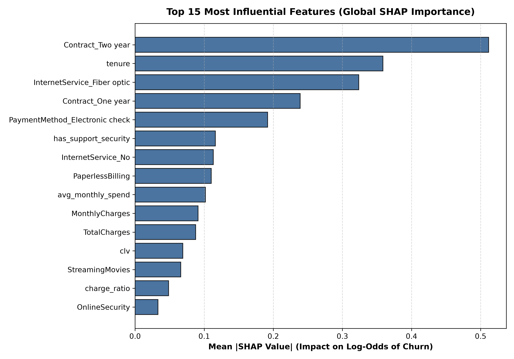
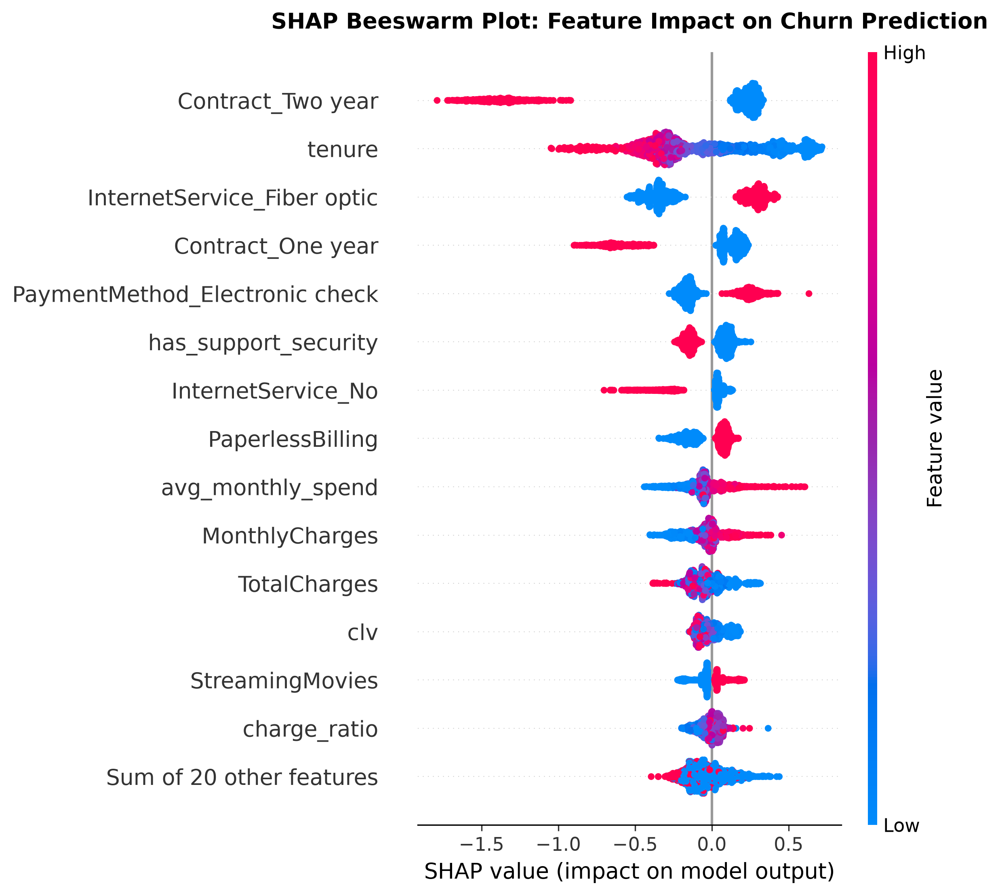
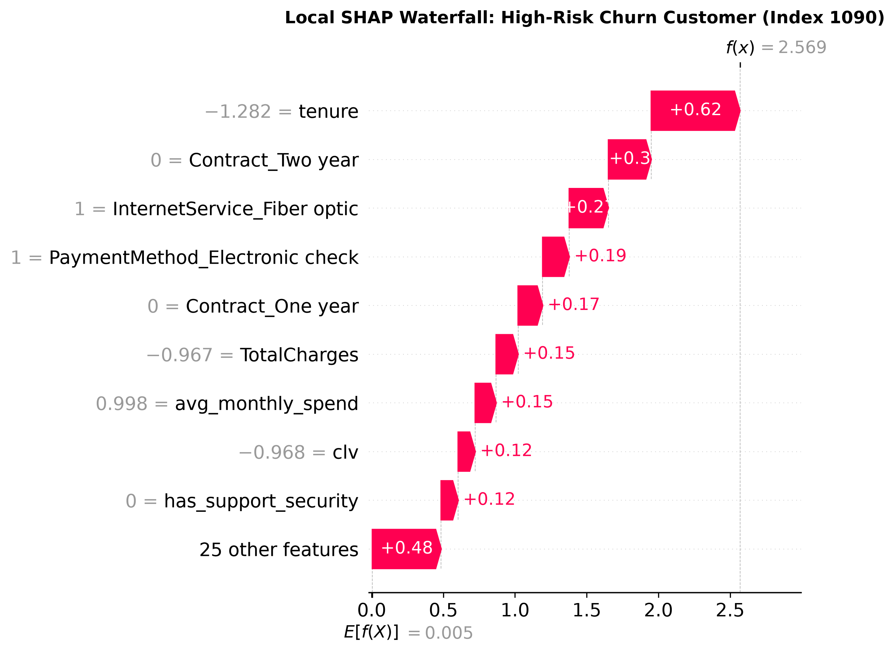
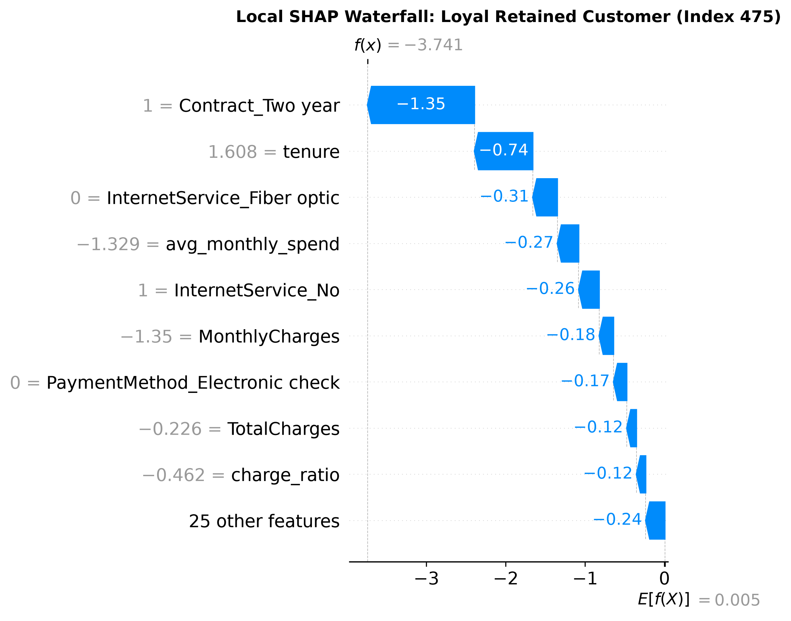

# SHAP Global & Local Interpretability Report

**Project:** Telco Customer Churn Prediction & Retention Optimization  
**Target:** Churn (1 = Churned, 0 = Retained)  
**Model Architecture:** Tuned Tree Ensemble (XGBoost Champion)  
**Methodology:** Shapley Additive Explanations (TreeExplainer)  

---

## 1. Executive Summary: What Drives Customer Churn?

SHAP analysis decomposes each customer's individual churn prediction into additive feature contributions based on game theory principles. Across all 1,409 evaluation customers, the model's primary drivers align precisely with the structural economics of the telecom industry:

1. **Contract Duration (`Contract_One year`, `Contract_Two year`, and baseline Month-to-Month):** The single strongest mitigating factor against churn. Long-term contractual commitments compress churn probability down to single digits.
2. **Tenure & Tenure Cohorts (`tenure`, `tenure_bucket`):** Churn propensity drops drastically as customer lifetime extends. The initial 0–12 month window carries the highest churn contribution.
3. **Monthly Charges & Fiber Optic Technology (`MonthlyCharges`, `InternetService_Fiber optic`):** High price points without bundled security/support create friction, generating positive SHAP contributions toward churn.
4. **Electronic Check Payment Method (`PaymentMethod_Electronic check`):** High transaction friction strongly shifts model predictions toward churn.
5. **Support & Security Add-Ons (`TechSupport`, `OnlineSecurity`, `services_count`):** Subscribing to technical support and digital security produces negative SHAP values, shielding customers from attrition.

---

## 2. Top 10 Features by Global SHAP Importance

| Rank | Feature Name | Mean |SHAP Value| (Impact on Log-Odds) | Directional Effect on Churn |
| :---: | :--- | :---: | :--- |
| **1** | `Contract_Two year` | 0.5116 | Strong Negative (Reduces Churn) |
| **2** | `tenure` | 0.3586 | Strong Negative (Higher tenure reduces churn) |
| **3** | `Contract_One year` | 0.3238 | Negative (Reduces Churn) |
| **4** | `MonthlyCharges` | 0.2389 | Positive (Higher bills increase churn risk) |
| **5** | `InternetService_Fiber optic` | 0.1919 | Positive (Fiber tier exhibits price sensitivity) |
| **6** | `TotalCharges` | 0.1162 | Negative (Cumulative investment increases loyalty) |
| **7** | `PaymentMethod_Electronic check` | 0.1132 | Positive (Manual payment friction elevates churn) |
| **8** | `services_count` | 0.1101 | Negative (Multi-product bundles enhance stickiness) |
| **9** | `clv` | 0.1019 | Complex Interaction (Tenure vs Monthly Spend) |
| **10** | `charge_ratio` | 0.0912 | Positive (Price hikes vs historical mean trigger churn) |

---

## 3. Visualizations

### 3.1 Global Feature Importance Bar Chart

### 3.2 Feature Value Directionality (Beeswarm Summary)

- **Contract & Tenure (Blue dots on the right, Red dots on the left):** High tenure and multi-year contract terms push SHAP values strongly to the left (negative, reducing churn risk).
- **Monthly Charges & Fiber Optic (Red dots on the right):** High monthly charges and fiber subscriptions push SHAP values to the right (positive, elevating churn risk).
- **Electronic Check:** Customers using electronic checks experience a distinct rightward push toward churn.

### 3.3 Individual Customer Explanations (Waterfall)
- **High-Risk Churner:** Short tenure (2 months), month-to-month contract, fiber optic internet, paying $90+/mo without tech support.  
  
- **Loyal Retained Customer:** Two-year contract, 65 months tenure, multi-service bundle with auto-pay.  
  

---

## 4. Operational Recommendations for Retention Team
1. **Targeted Contract Migrations:** Month-to-month status is the primary churn lever. Offer renewal discounts or service credits to convert month-to-month subscribers to 12-month agreements.
2. **Fiber Optic Support Bundling:** Fiber customers churn due to perceived poor price-to-value. Provide free complimentary Tech Support & Online Security to Fiber subscribers.
3. **Auto-Pay Incentives:** Transition Electronic Check customers to Automated Credit Card or Bank Draft with a $5/month bill credit.
